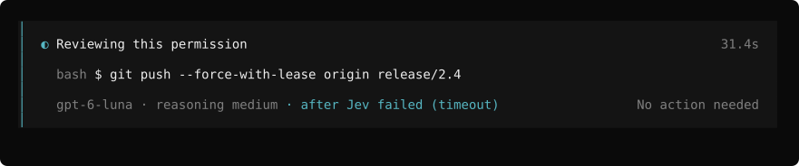

# TUI guide

What the reviewer shows in OpenCode's terminal UI. Every image is rendered from the plugin's own
components with sample statuses and OpenCode's default dark theme; [Development](DEVELOPMENT.md#tui-screens)
explains how. Toasts and the sidebar are drawn by OpenCode, so their images show only the text and
variant the plugin sends, without the host's frame.

The examples use Jev (`typesafe-ai/jev-1.13.0`) as the reviewer and `openai/gpt-6-luna` as the
`escalationReviewer`. The TUI names a model by the last segment of its ID, so they show as
`jev-1.13.0` and `gpt-6-luna`. Captions starting with `#` label the examples and are not part of
the TUI.

## While a review runs

### Progress strip (V2)

On OpenCode V2 a two-line strip sits at the bottom of the session while a review runs. Line 1 has
a spinner, "Reviewing this permission", the reviewer and its reasoning variant, and the elapsed
time. Line 2 has the permission and the action. When Jev hands a request to the reasoning
reviewer, line 1 names the reasoning reviewer and why it took over. The elapsed time keeps
counting from the start of the review.

### Overlay (V1)

On OpenCode V1 a larger overlay covers the native approval controls and says "No action needed".
After a hand-off, its model line names the reasoning reviewer and the reason for the hand-off.

## Results

When a review resolves, both hosts show a result strip for 5 seconds. Line 1 is the outcome, the
permission and the action. Line 2 says who decided, then the reason.

Line 2 for each way a review can end:

| What happened | Approved | Blocked |
| --- | --- | --- |
| Jev decided alone | `jev-1.13.0` | `jev-1.13.0` |
| Jev escalated | `gpt-6-luna after Jev's escalation` | `gpt-6-luna after Jev's escalation` |
| Jev approved but was unsure | `gpt-6-luna after Jev's uncertain approval` | `gpt-6-luna after Jev's uncertain approval` |
| A safety gate stopped Jev's approval | `gpt-6-luna after a safety gate stopped Jev's approval` | `gpt-6-luna after a safety gate stopped Jev's approval` |
| Jev's response was invalid | `gpt-6-luna after Jev's invalid response` | `gpt-6-luna after Jev's invalid response` |
| Jev failed, for example on a timeout | `gpt-6-luna after Jev failed (timeout)` | `gpt-6-luna after Jev failed (timeout)` |
| Jev denied but was unsure (`systemOneDenialReview`) | `gpt-6-luna overturned Jev's denial` | `gpt-6-luna confirmed Jev's denial` |

"Review blocked (fail-closed)" means the review ended in an escalation and unattended
(fail-closed) settings turned it into a block. A reviewer or a policy rule denying the request
shows plain "Review blocked".

## When you need to decide

When a review ends in a manual decision, the strip goes away, OpenCode's own approval controls
come back, and a toast says why. The reason follows the first sentence. Without a reason, the
toast falls back to a fixed sentence.

| Why | Variant | Title | Message |
| --- | --- | --- | --- |
| The reasoning reviewer reviewed it after Jev and it still needs you | warning | Manual review required | `gpt-6-luna reviewed this after Jev; it needs your approval: <reason>` |
| The reasoning reviewer failed | error | Reasoning reviewer unavailable | `gpt-6-luna failed (<kind>). This permission needs your approval. <reason>` |
| No review time was left for the hand-off | warning | Manual review required | `No review time left for gpt-6-luna after Jev (<cause>). <reason>` |
| The reviewer escalated without a hand-off | warning | Manual review required | the reviewer's reason |

Both hosts name the configured reasoning reviewer when no review time was left: V1 from its own
config, V2 from the reviewer's `status` RPC. When the TUI does not know it, the toast says "the
reasoning reviewer".

![Toast text for four manual outcomes. "Manual review required" (warning): "gpt-6-luna reviewed this after Jev; it needs your approval: The force-push would rewrite a shared branch." "Reasoning reviewer unavailable" (error): "gpt-6-luna failed (timeout). This permission needs your approval." followed by the failure reason. "Manual review required" (warning): "No review time left for gpt-6-luna after Jev (Jev escalated)." followed by the reason. "Manual review required" (warning) with only the reviewer's reason when there was no hand-off.](images/manual-toasts.svg)

## Config warnings

A setting that is on but cannot take effect, such as `systemOneEscalation: "reasoning-first"`
without an `escalationReviewer`, raises a warning toast. A degraded config, which keeps automatic
approval off until it is fixed, raises an error toast. Each distinct warning is shown once per TUI
session. On V2 the warnings arrive when the TUI connects; on V1 they arrive with the first review.

The sidebar keeps a line for as long as a warning applies. With several warnings it shows the
count and the first one; `opencode-permission-reviewer doctor` lists them all. A healthy config
shows no toast and no sidebar line.

## Long commands

Through version 3.0.0, the server flattened a command onto one line and cut off its end before the
TUI saw it, so the tail of a long pipeline, often the part that matters, never reached the screen.
Heredoc bodies were flattened into the command too.

Now the server splits the command into its separate commands and collapses a heredoc body it can
match to its line count. The TUI shows the first command, then as many of the last commands as fit,
with `⋯ N more ⋯` between them; a heredoc shows as `⋯ N-line heredoc ⋯`. A command that fits is
shown as sent, except that a matched heredoc body still shows as its line count, line continuations
show as `\⏎`, line breaks inside the shown text show as a muted `⏎`, and control or format
characters show as hex escapes. A cut falls between words unless that would leave a side less than
half used, as with a long URL; then it falls inside the word, with `⋯` at the cut. The reason line is
still cut at the end.

